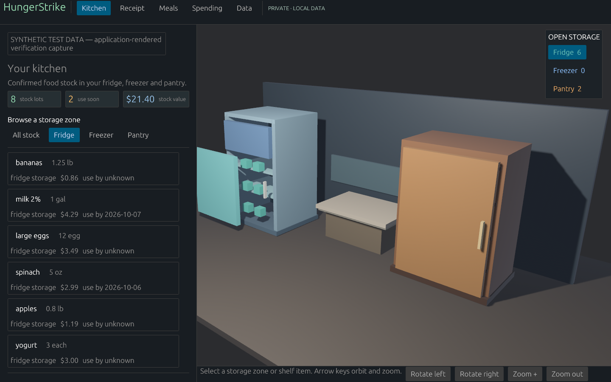
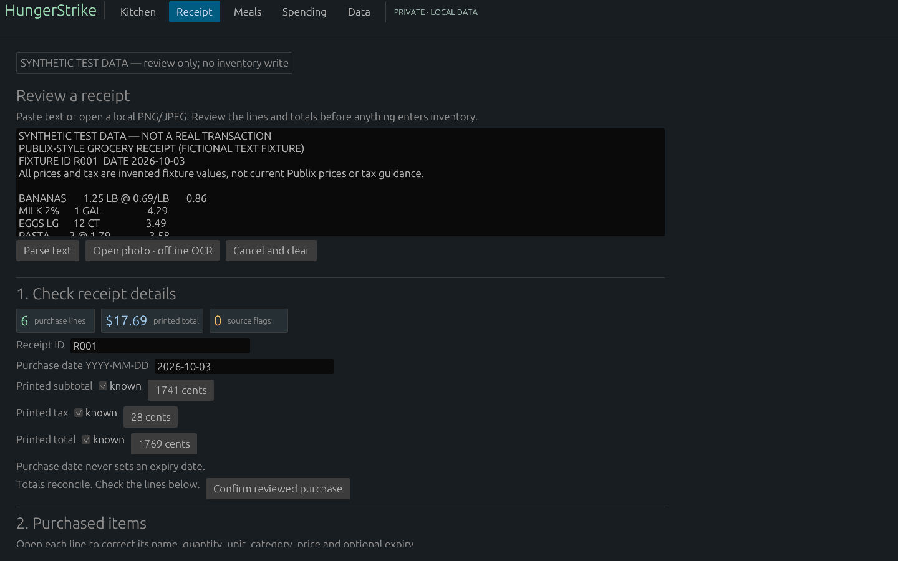
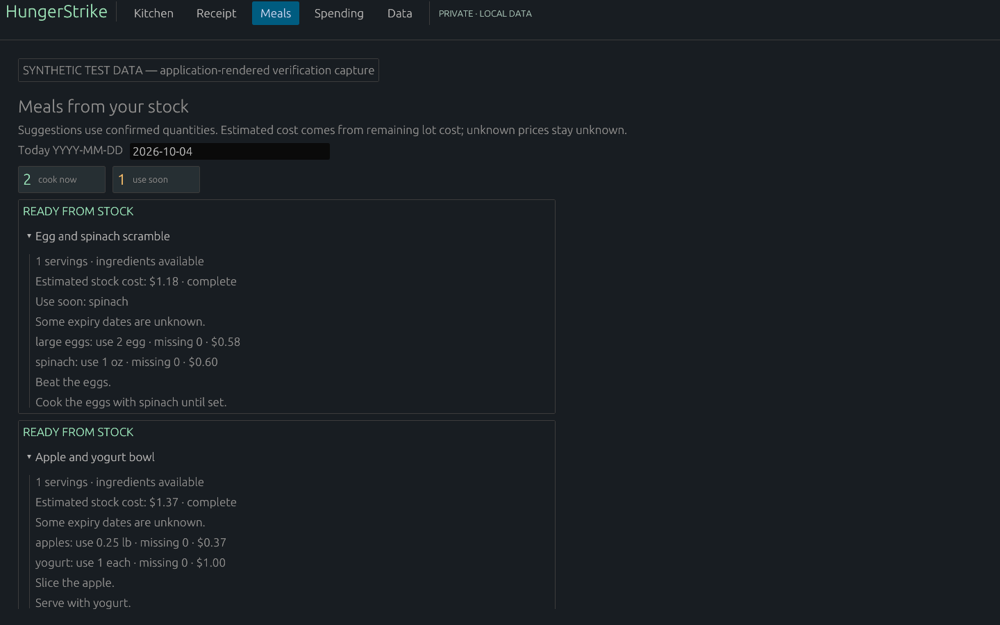
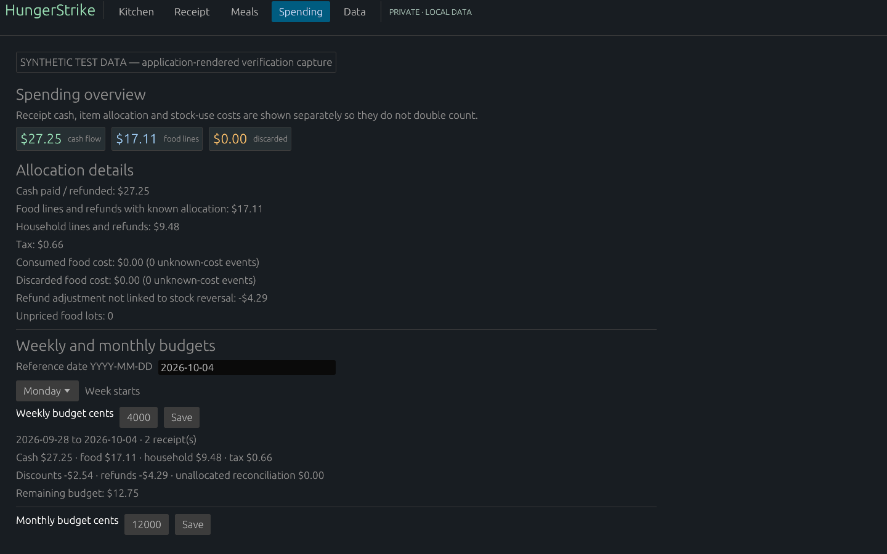

# HungerStrike

**by PWDS**

**Know what is in the kitchen, from the receipt onward.** HungerStrike brings reviewed purchases, local stock, meal ideas, and spending into one Windows desktop workspace. Every receipt stays a draft until you confirm what it says.



*Application-rendered Windows preview with synthetic test stock. The 3D kitchen and list show the same storage zones.*

[Walk through the app](docs/workflow.md) · [Build and launch](docs/launch.md) · [Verification and limits](verification.md)

## From a receipt to a useful kitchen

### Review before stock changes

Paste receipt text or open a local photo for optional offline OCR. Check the parsed lines, quantities, prices, categories, date, and totals before confirming. Duplicate detection, explicit separate-purchase acknowledgment, and correction guards help preserve the spending and inventory history.



*The pictured receipt is synthetic and shown in review mode; that capture made no inventory write.*

### See what is available

Browse the fridge, freezer, and pantry in the 3D scene or the matching stock list. Keep quantities and known costs tied to confirmed purchases, while unknown expiry dates and prices stay visibly unknown. Linked refunds can reverse stock from the original lot.

### Plan meals from confirmed stock

Meal suggestions use the quantities on hand. Ingredient availability, use-soon cues, and estimated remaining-lot costs are shown together; an unknown cost is not filled in with a guess.



### Keep spending and stock use distinct

The spending view separates receipt cash flow, food and household allocations, refunds, consumed food, and discarded food. Weekly and monthly budgets use those reviewed figures without counting stock use as another purchase.



## Run the Windows source preview

You need a local Rust toolchain and Cargo. From the repository root:

```powershell
cargo build --release -p hungerstrike-rust-desktop
.\target\release\hungerstrike-rust-desktop.exe
```

There is no installer or binary in this repository. Paste or type receipts without any OCR dependency. Photo OCR optionally uses a separately installed local English Tesseract at `C:\Program Files\Tesseract-OCR\tesseract.exe`; the engine and language model are not bundled. See [launch notes](docs/launch.md) for the input limits and local data path.

To run the repository tests:

```powershell
cargo test --workspace
```

## Status and data

This is a **Windows alpha source preview**. The [2026-10-10 verification record](verification.md) reports 57 passing workspace tests and inspected application-rendered frames on one Windows 11/NVIDIA setup. Native mouse and keyboard click-through, file dialogs, accessibility, other devices, and broader receipt/photo acceptance remain open. The separate [Android preview source branch](https://github.com/Gerbzz/HungerStrike/tree/android-preview) has no APK release or physical-device validation.

Confirmed inventory lives in local SQLite at `%LOCALAPPDATA%\HungerStrike\inventory.sqlite`. The **Data** tab can export a JSON backup and preview an import. The app has no account, cloud sync, telemetry, paid API, or runtime network call in this source checkpoint. Raw receipt lines, photo bytes, and OCR transcripts are not stored in SQLite or backups; reviewed fields and sanitized audit metadata are. [Workflow details](docs/workflow.md) explain confirmation, refunds, corrections, and backup choices.

The fixtures and screenshots use **synthetic test data**. Receipt parsing requires human review; it is not a universal receipt interpreter. No first-party source license has been selected for this public checkpoint.

Explore the other [PWDS Strike repositories](https://github.com/Gerbzz?tab=repositories&q=Strike) and the [PWDS Strike Launcher](https://github.com/Gerbzz/PWDS-Strike-Launcher).
