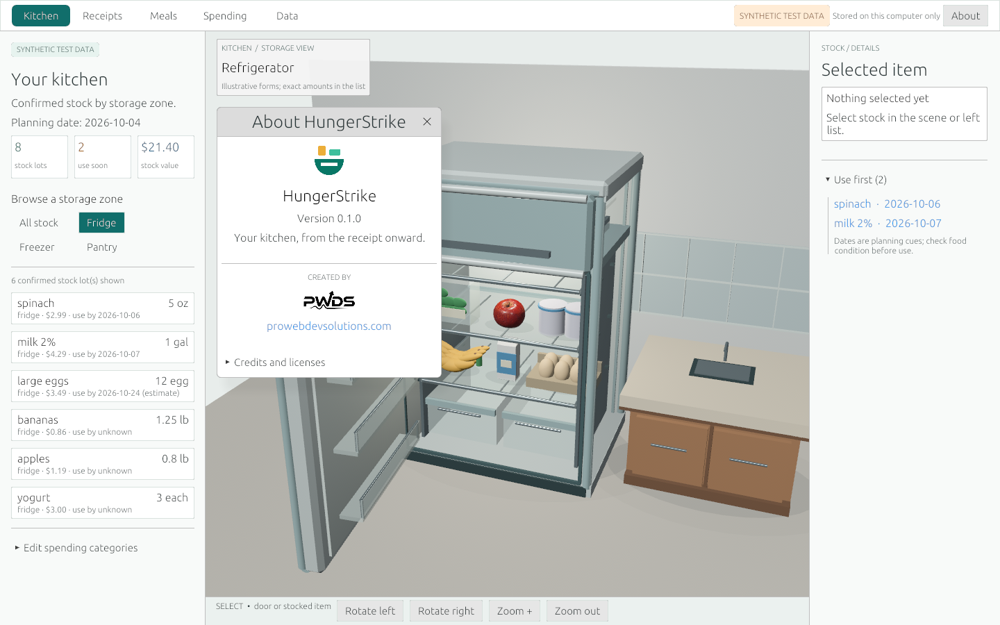
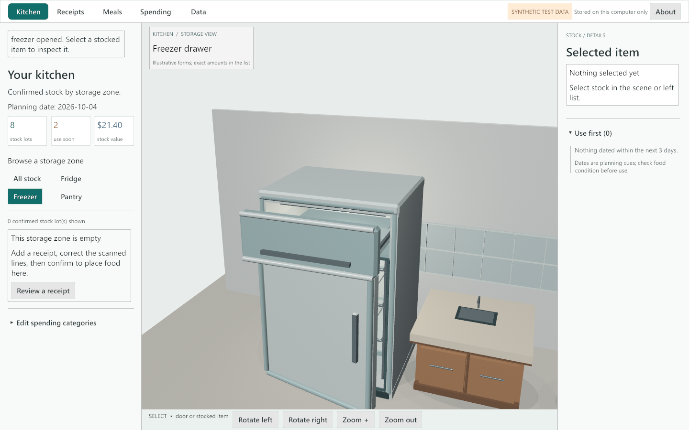
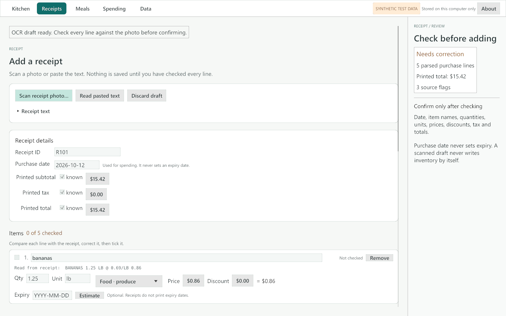
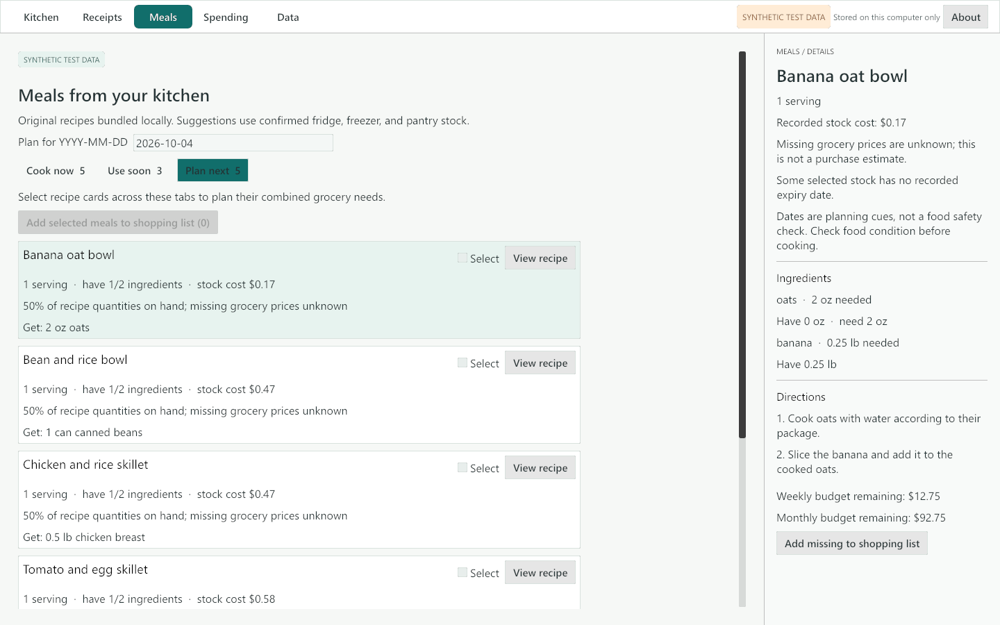

<p align="center">
  
</p>

<h1 align="center">HungerStrike</h1>

<p align="center"><strong>A free, local-first kitchen assistant: from the receipt to the fridge to dinner.</strong></p>

<p align="center">
  <code>100% Rust</code> · <code>Windows source preview (alpha)</code> · <code>offline · no account · no paid API</code>
</p>

<p align="center">
  <a href="#what-works-today">What works</a> ·
  <a href="#how-receipt-scanning-works">Receipt scanning</a> ·
  <a href="#implemented-vs-planned">Implemented vs planned</a> ·
  <a href="#build-and-run">Build and run</a> ·
  <a href="#verification-status">Verification</a> ·
  <a href="#credits-and-licenses">Credits</a>
</p>

HungerStrike scans grocery receipts on your own computer, lets you check and correct every line, keeps track of what is in the fridge, freezer and pantry, puts the food that needs using first at the top, suggests recipes from what you have, builds a shopping list for what you are missing, and shows what you spend on food. Everything is stored locally in SQLite.

## Rust direction and migration status

- **Target:** Continue building HungerStrike as a Rust local-first kitchen application; its application core and desktop are already Rust, so this is extension and hardening rather than a new language rewrite.
- **Current implementation:** Published `main` contains [`core/`](core/) for local pantry/receipt data and [`desktop/`](desktop/) for the Bevy/egui interface and offline OCR integration. SQLite storage and existing receipt-review safeguards remain part of the implementation.
- **Remaining migration:** No wholesale application-language migration is required. Remaining work is feature completion and verification: representative receipt accuracy, native workflows and accessibility, durable data handling, and distribution. Bounded tests or synthetic captures are not full product acceptance.

<p align="center"></p>
<p align="center"><sub>Native Linux app capture of Kitchen and About, using synthetic data. Built from reviewed tree <code>94888d1</code>, merged in <code>6c1cf6d</code>. <a href="docs/CAPTURE_2026-10-21_GEOMETRIC.md">Capture source, checks and limits</a>.</sub></p>

<details>
<summary>Historical Windows views — October 17, 2026, source 7222c4b</summary>

These older captures document the selected-stock, receipt and meal workflows at that source checkpoint. They are retained as historical examples; they do not show the current branding. [Original gallery and provenance](docs/CAPTURE_2026-10-17.md).

<p align="center"></p>
<p align="center">
  
  
</p>

</details>

## What works today

| Area | What you can do |
| --- | --- |
| **Receipts** | Scan a PNG/JPEG receipt photo with the bundled offline OCR engine, or paste receipt text. The draft shows each line with the text the scanner read, and editable name, quantity, unit, category, price and discount. Plain-language hints say which field or total does not reconcile. **Nothing is saved until every line is ticked as checked** and the subtotal, tax and total reconcile. Duplicate receipts are recognised and never charged twice. Corrections and refunds are audited. |
| **Expiry** | Receipts do not print expiry dates, so a scanned line never gets one. You can type the package date, or ask for a rough **estimate**, which is saved as an estimate and labelled "(estimate)" everywhere until you replace it. |
| **Kitchen** | A 3D virtual kitchen (fridge, freezer, pantry) and a matching stock list. Select an item to consume, discard, move it between zones, or set, estimate or clear its expiry. Stock is sorted soonest-expiry first, and a **Use first** list links to anything dated within three days. |
| **Meals** | Ten bundled original recipes. *Cook now* uses stock you have; *Use soon* prefers recipes that use dated stock; *Plan next* ranks recipes by how few ingredients are missing. Cooking previews the exact lots before stock changes. Missing ingredients for one or several selected meals can be added to a combined local shopping list. |
| **Spending** | Cash paid, food vs household allocations, refunds, consumed and discarded food cost, with weekly and monthly budgets. |
| **Data** | Export a JSON backup, preview an import, replace or reconcile, and undo the last replacement. If the local database is ever unreadable it is renamed aside (never deleted) and a fresh one is started, with a message saying where the old file is. |

## How receipt scanning works

1. **Scan receipt photo…** opens a file picker. The image is checked (PNG/JPEG, at most 8 MB and 40 megapixels) and decoded on a worker thread; a corrupt or truncated file is rejected before any draft exists.
2. The [ocrs](https://github.com/robertknight/ocrs) engine finds and reads text lines using two small models that are compiled into the executable. Lines are rebuilt into receipt rows (item name on the left joined with the price on the right, with slight tilt corrected) and handed to the receipt parser.
3. You review the draft. **Cancel scan** stops a running job; **Discard draft** clears it. Photo bytes and OCR text are never written to the database or backups.

OCR quality depends on the photo. The bundled engine reads the repository's labelled synthetic receipts (see `tests/images/`), but real receipts with faded thermal paper, unusual fonts or heavy creasing will need more correction, which is why the line-by-line review is mandatory. No real receipt has been tested.

## Implemented vs planned

| Feature | Status |
| --- | --- |
| Local receipt OCR (bundled, offline) | Implemented; tested in CI on synthetic images only |
| Paste/typed receipt entry | Implemented |
| Mandatory per-line review before saving | Implemented |
| Labelled, opt-in expiry estimates; editable expiry on stock | Implemented |
| Inventory by zone, consume/discard/move | Implemented |
| Use-first prioritisation | Implemented (3-day window, sorted lists) |
| Recipe suggestions and combined shopping list | Implemented (bundled recipes only) |
| Spending and budgets | Implemented |
| Backup, restore, undo; corrupt-database recovery | Implemented |
| Virtual 3D kitchen | Implemented as an illustrative kitchen; it does not reconstruct a real kitchen from photos |
| Camera capture | Planned (file import only today) |
| Android | Planned. A stale [android-preview branch](https://github.com/Gerbzz/HungerStrike/tree/android-preview) has a Bevy NativeActivity build that was run on an emulator in October; it is not merged and no Android support is claimed. The bundled OCR is pure Rust, so it does not block an Android port the way an external Tesseract did. |
| Linux, macOS | Prior portability candidate built and tested in hosted CI (see [Platforms](#platforms)); integrated migration/branding candidate requires fresh validation; not hands-on tested |
| iOS | Not built or tested |
| Installer / signed release | Not available |

## Build and run

You need a stable Rust toolchain ([rustup](https://rustup.rs)) plus the per-OS prerequisites below. SQLite and the OCR engine are compiled in, so nothing else needs installing.

| OS | Build prerequisites |
| --- | --- |
| Windows 10/11 | Visual Studio Build Tools with the "Desktop development with C++" workload (MSVC and the Windows SDK). |
| macOS | Xcode Command Line Tools (`xcode-select --install`). |
| Linux (Debian/Ubuntu) | `sudo apt-get install pkg-config libasound2-dev libudev-dev libwayland-dev libxkbcommon-dev` and a C compiler (`build-essential`). Running needs a Vulkan or OpenGL driver (Mesa is fine). The file picker and error dialogs use the XDG desktop portal (`xdg-desktop-portal` plus a backend such as `-gtk` or `-kde`), with `zenity` as the fallback; no GTK development headers are needed to build. Other distributions need the equivalent ALSA, udev, Wayland and xkbcommon development packages. |

From the repository root:

```sh
cargo build --release -p hungerstrike-rust-desktop
cargo test --workspace
# Windows: .\target\release\hungerstrike-rust-desktop.exe
# macOS / Linux: ./target/release/hungerstrike-rust-desktop
```

The app loads its 3D models from an `assets` folder next to the executable; when running from `target/release`, set `HUNGERSTRIKE_ASSETS_DIR` to the repository's `assets` folder (the CI binary artifacts already include `assets/`).

The OCR crates are optimised even in debug builds (see `[profile.dev.package.*]` in `Cargo.toml`) so the tests run in seconds. Set `HUNGERSTRIKE_DATA_DIR` to use a separate profile. Otherwise local data lives at:

| OS | Data file |
| --- | --- |
| Windows | `%LOCALAPPDATA%\HungerStrike\inventory.sqlite` (unchanged from earlier builds) |
| macOS | `~/Library/Application Support/HungerStrike/inventory.sqlite` |
| Linux | `$XDG_DATA_HOME/HungerStrike/inventory.sqlite`, normally `~/.local/share/HungerStrike/inventory.sqlite` |

Earlier macOS/Linux source builds wrote to `./HungerStrike/inventory.sqlite` under the working directory. On first start the app copies that database to the location above if nothing is there yet, and leaves the original in place. See [launch notes](docs/launch.md) and the [workflow walkthrough](docs/workflow.md).

For isolated, clearly labelled synthetic captures, set `HUNGERSTRIKE_CAPTURE_DEMO` to one of `kitchen`, `selected`, `receipt`, `receipt-photo`, `plan-next`, `spending`, `about` or `launch`, plus `HUNGERSTRIKE_CAPTURE_PATH` (optionally `HUNGERSTRIKE_CAPTURE_SIZE`, `HUNGERSTRIKE_CAPTURE_DELAY`, `HUNGERSTRIKE_CAPTURE_THEME`, and `HUNGERSTRIKE_CAPTURE_EXIT=1` to quit once the image is written), and point `HUNGERSTRIKE_DATA_DIR` at a throwaway folder. These routes show a **SYNTHETIC TEST DATA** label.

## Platforms

A platform is listed as **supported** only after hosted CI has built and tested it there, with a link to the run. Anything less is labelled as such.

| Platform | Status |
| --- | --- |
| Windows (x86_64, `windows-latest`) | **Supported.** Hosted CI built the workspace, passed `cargo clippy --workspace --all-targets -- -D warnings` and `cargo test --workspace` (117 passed, 0 failed), and built the release binary at `ab963dc`: [run 39197430196](https://github.com/Gerbzz/HungerStrike/actions/runs/39197430196). The headless capture is best-effort there and produced no image: the runner's only adapter, the WARP software D3D12 driver, removes the device (DXGI `0x887A0005`) within seconds of opening the 3D scene. Light and Dark app captures were made on one local Windows 11 PC instead. |
| Linux (x86_64, `ubuntu-latest`) | **Supported** (CI only, not hands-on tested). Same clippy, 117 tests and release build passed at `ab963dc`: [run 39197430196](https://github.com/Gerbzz/HungerStrike/actions/runs/39197430196). The release app rendered Light and Dark synthetic captures under Xvfb with Mesa llvmpipe (Vulkan). |
| macOS (arm64, `macos-latest`) | **Supported** (CI only, not hands-on tested). Same clippy, 117 tests and release build passed at `ab963dc`: [run 39197430196](https://github.com/Gerbzz/HungerStrike/actions/runs/39197430196). The release app rendered Light and Dark synthetic captures on the runner's paravirtual Metal device; the runner's small display limited the window to 1024x680. |
| Android, iOS | Not claimed. See *Implemented vs planned*. |

The [Cross-platform workflow](.github/workflows/cross-platform.yml) runs all of this on every pull request and uploads `hungerstrike-desktop-<os>` (release binary plus `assets/`) and `hungerstrike-screenshots-<os>` (captures and logs) as artifacts. "Supported" here means built and tested in hosted CI. Mouse and keyboard use, file dialogs and live theme switching have not been tested by hand on Linux or macOS, and only on one PC on Windows.

## Verification status

See [verification.md](verification.md) for the earlier dated record and [the October 21 capture record](docs/CAPTURE_2026-10-21_GEOMETRIC.md) for the reviewed branding tree merged in `6c1cf6d`:

- **Tests:** [Hosted Windows CI](https://github.com/Gerbzz/HungerStrike/actions/runs/39689376639) passed formatting and the workspace tests (103 tests: 76 core, 27 desktop) on the reviewed branding tree. They cover receipts, ledger, budgets, backups, recipes, database recovery, expiry estimates, bundled OCR on synthetic images, corrupt images, cancellation, timeout, per-line review gating, duplicate photo imports and app actions.
- **Current native capture:** [hosted Linux CI](https://github.com/Gerbzz/HungerStrike/actions/runs/39689376824) built the native app and produced the unmodified 1440 × 900 Kitchen/About image above. The geometric mark, app name and synthetic-data labels are visible. This is an automated capture, not an interactive acceptance test.
- **Historical frames:** the [October 17 gallery](docs/CAPTURE_2026-10-17.md) records the earlier source checkpoint, including an OCR draft from a synthetic photo, reopening a saved profile, and recovery from a corrupted database file.
- **Not verified:** native mouse/keyboard click-through, the file dialog and 3D picking on this build (the hosted capture does not establish those interactions); `cargo clippy` for the desktop crate (Windows Smart App Control blocked a build-time library, see verification.md); real receipts; other PCs, GPUs and DPI settings; screen readers.

### Portability and safe migration candidate

The earlier portability source `0ecd19e` passed the [three-OS build/test workflow](https://github.com/Gerbzz/HungerStrike/actions/runs/39252501361). It is now integrated with the geometric branding above and a reviewed SQLite migration repair; fresh checks on that combined source are required. Those prior results are not proof of the combined build. The [October 18 theme capture record](docs/CAPTURE_2026-10-18_THEMES.md) remains historical evidence, not current branding.

Migration uses a consistent SQLite backup and atomic no-clobber publication, not independent copies of live WAL/journal files. Existing data remains in place. Missing legacy data permits a normal first start; unreadable, corrupt, locked or nonregular legacy paths and conflicting destination sidecars stop startup rather than silently opening an empty kitchen. Legacy symlinks require manual resolution. Atomicity protects the published database and cooperating app launches, not arbitrary unrelated sidecar writers. The nine migration regressions and all 87 core tests passed locally; native startup and the combined three-OS checks remain separate gates.

## Data and privacy

No account, telemetry, cloud sync or runtime network call. Receipt photos and OCR text stay in memory until you confirm or discard; only reviewed fields and sanitized audit metadata are stored. All fixtures in this repository are **synthetic test data** with invented prices.

## Credits and licenses

- Receipt OCR: [ocrs](https://github.com/robertknight/ocrs) and [rten](https://github.com/robertknight/rten) by Robert Knight (MIT OR Apache-2.0).
- OCR models: the published ocrs text detection and recognition models (CC BY-SA 4.0), redistributed unmodified; sources and hashes in [assets/ocr/NOTICE.md](assets/ocr/NOTICE.md).
- 3D food models: [Poly Haven](https://polyhaven.com) (CC0); see [assets/models/polyhaven/PROVENANCE.md](assets/models/polyhaven/PROVENANCE.md).
- Built with [Bevy](https://bevyengine.org), [egui](https://github.com/emilk/egui) and SQLite via rusqlite.
- HungerStrike's geometric pantry mark is original ([identity notes](assets/branding/GEOMETRIC-IDENTITY.md)). The original dormouse artwork is preserved ([provenance](assets/branding/provenance.json)). PWDS company marks appear only on the launch screen and in About.
- This README's layout loosely follows the structure of the [PhotoCraft README](https://github.com/storytold/photocraft) (tagline, jump links, feature table, status, credits). No text or assets were copied.

No license has been chosen yet for HungerStrike's own source code. Bundled third-party files keep their own licenses as listed above.

Part of the PWDS Strike suite by [ProWebDevSolutions](https://prowebdevsolutions.com). See the other [Strike repositories](https://github.com/Gerbzz?tab=repositories&q=Strike).
