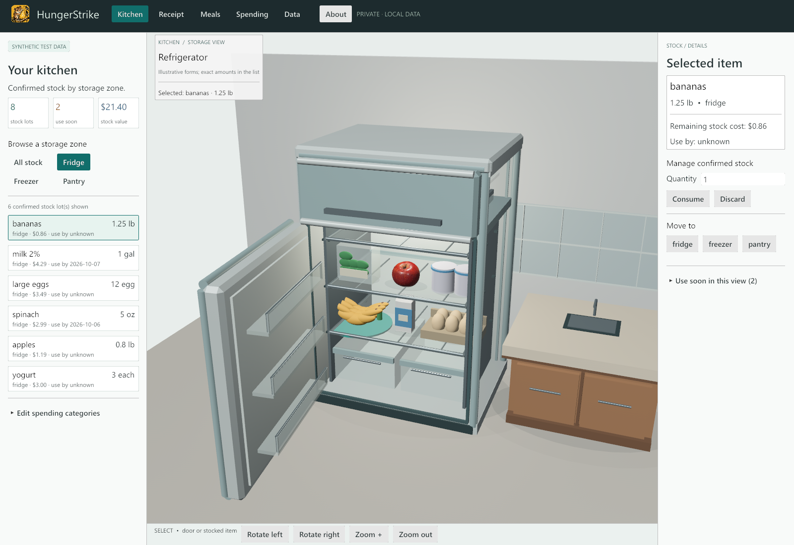

<p align="center">
  
</p>

<h1 align="center">HungerStrike</h1>

<p align="center">
  <a href="https://prowebdevsolutions.com"><picture>
    <source media="(prefers-color-scheme: dark)" srcset="assets/branding/PWDS-logo-orange.svg">
    
  </picture></a>
</p>

<p align="center"><strong>Know what is in the kitchen, from the receipt onward.</strong></p>

HungerStrike brings reviewed purchases, local stock, meal ideas, and spending into one Windows desktop workspace. Every receipt stays a draft until you confirm what it says.

<p align="center"></p>

The [Kitchen](assets/screenshots/hungerstrike-kitchen-light-34405b7-1600x1100.png), [1280 × 720 Kitchen](assets/screenshots/hungerstrike-kitchen-light-34405b7-1280x720.png), [Cook now](assets/screenshots/hungerstrike-meals-light-34405b7-1600x900.png), [Plan next](assets/screenshots/hungerstrike-plan-next-light-34405b7-1600x900.png), [saved shopping list](assets/screenshots/hungerstrike-shopping-light-34405b7-1600x900.png), [post-Cook stock](assets/screenshots/hungerstrike-cooked-light-34405b7-1600x900.png), and [launch](assets/screenshots/hungerstrike-launch-light-34405b7-1600x900.png) are genuine app-rendered frames from the `34405b7` executable. The corrected [About](assets/screenshots/hungerstrike-about-light-2c122bf-1600x900.png) and [1280 x 720 About](assets/screenshots/hungerstrike-about-light-2c122bf-1280x720.png) frames come from the newer `2c122bf` executable. See [capture provenance and limits](docs/CURRENT_CAPTURE_PROVENANCE.md). Earlier [light frames](docs/LIGHT_SCREENSHOT_PROVENANCE.md) and the [dark public-version image](docs/SCREENSHOT_PROVENANCE.md) remain preserved as historical evidence.

<p align="center"><a href="docs/workflow.md">Walk through the app</a> · <a href="docs/launch.md">Build and launch</a> · <a href="verification.md">Verification and limits</a> · <a href="assets/branding">Original artwork</a></p>

## From a receipt to a useful kitchen

### Review before stock changes

Paste receipt text or open a local photo for optional offline OCR. Check the parsed lines, quantities, prices, categories, date, and totals before confirming. Duplicate detection, explicit separate-purchase acknowledgment, and correction guards help preserve the spending and inventory history.

### See what is available

Browse the fridge, freezer, and pantry in the 3D scene or the matching stock list. Keep quantities and known costs tied to confirmed purchases, while unknown expiry dates and prices stay visibly unknown. Linked refunds can reverse stock from the original lot.

### Plan meals from confirmed stock

Ten original recipes are bundled locally, including pantry staples such as rice, canned beans, and oats. Cook now uses sufficient confirmed stock; Use soon prioritizes recipes using dated stock; Plan next ranks missing-grocery ideas by the number of missing ingredients and then by how much of their required quantities are on hand. It shows missing quantities and saves selected needs to a local shopping list. The selected recipe previews the exact lots before an explicit Cook action updates inventory. Recorded stock costs and known budgets are shown, while missing-grocery prices remain unknown. [Recommendation method and limits](docs/PANTRY_RECOMMENDATIONS_2026-10-16.md).

### Keep spending and stock use distinct

The spending view separates receipt cash flow, food and household allocations, refunds, consumed food, and discarded food. Weekly and monthly budgets use those reviewed figures without counting stock use as another purchase.

## Run the Windows source preview

You need a local Rust toolchain and Cargo. From the repository root:

```powershell
cargo build --release -p hungerstrike-rust-desktop
.\target\release\hungerstrike-rust-desktop.exe
```

There is no installer or binary in this repository. Paste or type receipts without any OCR dependency. Photo OCR optionally uses a separately installed local English Tesseract at `C:\Program Files\Tesseract-OCR\tesseract.exe`; the engine and language model are not bundled. See [launch notes](docs/launch.md) for the input limits and local data path.

To run the repository tests:

```powershell
cargo test --workspace
```

## Status and data

This is a **Windows alpha source preview**. The [light-interface recovery record](docs/verification/LIGHT_UI_SOURCE_RECOVERY.md) tracks its source. The reviewed source passed 73 offline workspace tests (55 core, 18 desktop). Earlier source `2c122bf` built as a guarded desktop release, and the source-labeled light captures show isolated synthetic shopping and post-Cook stock. The later recipe date-ordering and freshness-cue changes have not received a new release capture. Native mouse and keyboard interaction remains unverified.

The [2026-10-10 verification record](verification.md) reports 57 passing workspace tests and inspected application-rendered frames on one Windows 11/NVIDIA setup. Native mouse and keyboard click-through, file dialogs, accessibility, other devices, and broader receipt/photo acceptance remain open. The separate [Android preview source branch](https://github.com/Gerbzz/HungerStrike/tree/android-preview) has no APK release or physical-device validation.

Confirmed inventory lives in local SQLite at `%LOCALAPPDATA%\HungerStrike\inventory.sqlite`. The **Data** tab can export a JSON backup and preview an import. The app has no account, cloud sync, telemetry, paid API, or runtime network call in this source checkpoint. Raw receipt lines, photo bytes, and OCR transcripts are not stored in SQLite or backups; reviewed fields and sanitized audit metadata are. [Workflow details](docs/workflow.md) explain confirmation, refunds, corrections, and backup choices.

The included fixtures use **synthetic test data**. Receipt parsing requires human review; it is not a universal receipt interpreter. No first-party source license has been selected for this public checkpoint.

Explore the other [PWDS Strike repositories](https://github.com/Gerbzz?tab=repositories&q=Strike) and the [PWDS Strike Launcher](https://github.com/Gerbzz/PWDS-Strike-Launcher).

## PWDS brand artwork

The company mark in this masthead is the existing [official PWDS logo](https://github.com/Gerbzz/PWDS-Website/blob/main/public/prowebdevsolutions-logo.png), with the [official orange display asset](https://prowebdevsolutions.com/images/prowebdevsolutions-logo-orange.svg) for dark backgrounds. The HungerStrike mark above it is the centered transparent version of the original dormouse artwork, with [provenance](assets/branding/provenance.json). In the desktop source, PWDS attribution appears on launch and About surfaces, while the working header carries HungerStrike's own name and icon.
